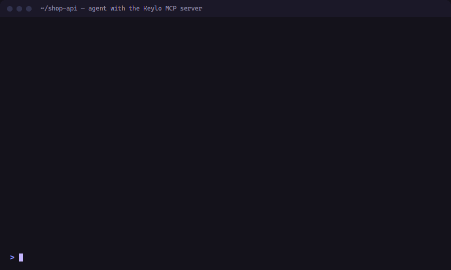
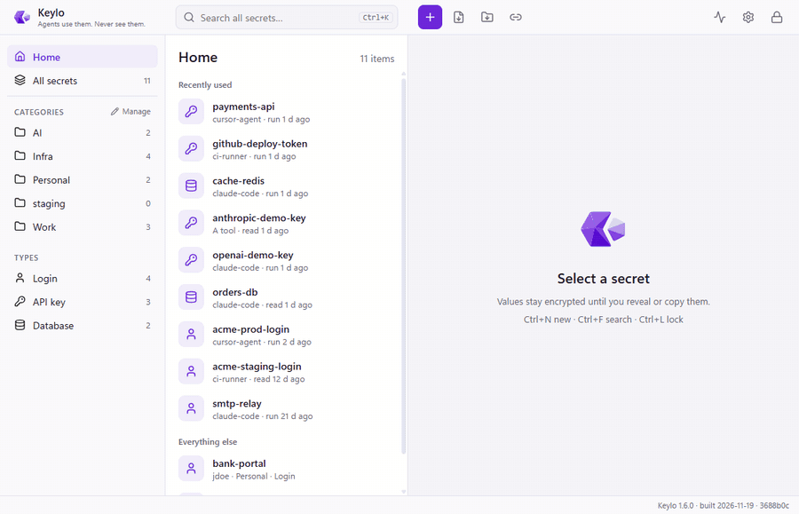

<h1>&nbsp;Keylo</h1>

*Agents use them. Never see them.*

[](https://github.com/tulde23/keylo/releases/latest)
[](LICENSE)


<p align="center"></p>

Keylo is a secrets manager for developers working with AI agents. Agents use your API keys,
passwords and tokens without ever seeing their values: secrets go straight into the commands that
need them and are redacted from the output, so they don't end up in conversation logs or get pasted
into your code and commit history.

It runs on your own computers, with a desktop app (`keylow`), a command line (`keylo`) and an MCP
server for agents (`keylo mcp`). On each computer, secrets live in an encrypted vault whose key the
operating system protects — your Windows account on Windows, your login Keychain on macOS, your desktop
keyring on Linux. There's no Keylo server and no account. To use the same secrets on several computers, Keylo can
[sync them](#sync-between-your-devices) end-to-end encrypted, through a folder you already sync with
OneDrive, iCloud Drive, Dropbox or Syncthing.

---

## Contents

- [The problem Keylo solves](#the-problem-keylo-solves)
- [How it works](#how-it-works)
- [Features](#features)
- [Install](#install)
- [Updates](#updates)
- [Quick start](#quick-start)
- [Concepts](#concepts)
- [The desktop app](#the-desktop-app)
- [Command line reference](#command-line-reference)
- [AI agents: the MCP server](#ai-agents-the-mcp-server)
- [Linked secrets: 1Password and AWS Secrets Manager](#linked-secrets-1password-and-aws-secrets-manager)
- [Pushing secrets to another vault](#pushing-secrets-to-another-vault)
- [Import, export, backup and restore](#import-export-backup-and-restore)
- [Sync between your devices](#sync-between-your-devices)
- [Security model](#security-model)
- [Configuration](#configuration)
- [Platform notes](#platform-notes)
- [Troubleshooting](#troubleshooting)
- [Building from source](#building-from-source)
- [Security](#security)
- [Contributing](#contributing)
- [License](#license)

---

## The problem Keylo solves

AI coding agents (Claude Code, Cursor, Copilot and the like) run commands for you: deploys,
migrations, API calls, `git push`. Those commands need credentials, and the usual ways of providing
them all leak:

- **`.env` files and key folders** sit in plain text next to your code. Agents read them, quote them
  back, and sometimes commit them.
- **Pasting a key into the chat** puts it in the conversation history, in logs, and wherever that
  conversation is stored or synced.
- **Exported environment variables** reach every process you start, and an agent that runs `env` or
  `printenv` prints them all.
- **Command output** echoes tokens back (`curl -v`, debug logging, error messages), and that output
  goes straight into the agent's context.
- **No record or control.** You can't see which agent used which credential, and you can't say "this
  one, not that one" or "ask me first for production".

A conventional password manager keeps secrets safe from people, but its job ends when it hands the
value over. Once a value is in an agent's context it has leaked, however carefully it was stored.

## How it works

Keylo hands the value to the **command**, never to the **agent**.

**An example.** Say you've saved your production database's login in Keylo as a *database* secret
and named it `prod-db` (the name is yours to choose; Keylo has no built-in secrets). You ask Claude
Code to run your project's database migrations, `npm run migrate`, which reads the connection string
from the `DATABASE_URL` environment variable:

1. **The agent finds the secret by name, never by value.** Keylo's `search_secrets` tool returns
   `prod-db`, its type and field names, and whether the agent's access key lets it use the secret.
2. **The agent asks Keylo to run the command,** saying which environment variable gets which secret:
   `run_with_secrets` with `{"DATABASE_URL": "prod-db:connection_string"}` and `npm run migrate`.
   (`prod-db:connection_string` means "the `connection_string` field of the secret named `prod-db`".)
3. **Keylo checks the agent's access key.** If `prod-db` is outside the key's scope, an **approval
   window** opens on your screen, confirmed with Windows Hello, Touch ID or your system password.
4. **Keylo starts the command** with the value in `DATABASE_URL`. If the value shows up in the
   command's output, Keylo replaces it with `[keylo:prod-db]` before the agent sees the output.
5. **The use is written to an audit log,** with the key, the secret and the process that asked.

There is no tool that returns a value. An agent can use a secret, but it can't read it.

> Secret names in this guide, such as `prod-db`, `github-token` and `stripe/live-key`, are examples
> of names you might give your own secrets.

## Features

**For agents**
- MCP server (`keylo mcp`) with tools to search secrets, list categories and types, run commands with
  secrets, request access, and browse AWS Secrets Manager.
- Per-agent **access keys** that cover chosen categories and secrets, or everything, with optional
  expiry. Keys are stored only as SHA-256 hashes.
- **Approvals** for anything outside a key's scope: Deny, Allow once (for your session) or Always
  allow (adds it to the key), each confirmed with your identity check.
- **Output redaction** of every value a command received, including values from earlier commands.
- **"Always ask" environments**: uses of production secrets need your approval every time, whatever
  the key covers.
- **Audit log** of every use by an agent, with the calling process chain.
- One-step setup for Claude Code (`keylo keys create … --add-to-claude`, or a button in the app).

**For you**
- Desktop app for Windows, macOS and Linux, with a command line that does everything the app does.
- **14 built-in secret types** (login, API key, password, database, SSH key, secure note, server,
  email account, software license, wireless router, crypto wallet, document, credit card, bank
  account) plus your own **custom types**, each with named fields.
- **Categories** with icons and colours, pinned and recently used secrets, and search across names,
  categories, usernames, notes and non-secret fields.
- **Linked secrets**: point at items in **1Password** or **AWS Secrets Manager** and read them live,
  with **per-environment links** (`orders-db@uat`, `orders-db@prod`).
- **Push** secrets into 1Password or AWS Secrets Manager.
- **Import** files and folders as secrets, with type detection (SSH keys, database URLs, tokens).
- **Import from another password manager:** CSV exports from Chrome, Edge, Firefox, Bitwarden,
  1Password, LastPass, KeePassXC and Apple Passwords, with folders, notes and one-time codes.
- **Export to another password manager:** a Bitwarden CSV, or the browser format most password
  managers import, so you're never locked in.
- **Protect the vault** with an optional **master passphrase** (Windows and macOS), and unlock it with
  **Windows Hello** (TPM) or **Touch ID** (Secure Enclave) — a gesture instead of typing it — while the
  passphrase stays your recovery key. A built-in generator offers a strong, memorable passphrase.
- **Encrypted backups** (AES-256-GCM, password-protected) that restore on any OS — your portable
  recovery kit if you forget the passphrase or lose the machine.
- **Sync between your own devices** through a folder they already share (OneDrive, iCloud Drive,
  Dropbox, Syncthing), end-to-end encrypted, with conflict copies instead of lost edits.
- **One-time codes** (two-factor, TOTP): store a site's setup key with a login, then show or copy its
  current code in the app, with `keylo otp`, or in agents' commands.
- A **secure clipboard**: copied values skip clipboard history and cloud sync, and clear themselves.
- An identity check (Windows Hello, Touch ID or polkit) once per session, on every use, or never.
- Locks when your screen locks. Three colour themes, light and dark.

---

## Install

Download the latest release from **[Releases](https://github.com/tulde23/keylo/releases/latest)**.
Releases are numbered `major.minor.build` (for example 1.3.20); below, `VERSION` stands for the one
you downloaded. Every release has a `SHA256SUMS.txt`. Check your download against it:

```powershell
# Windows (PowerShell)
(Get-FileHash .\keylo-VERSION-windows-x64.zip -Algorithm SHA256).Hash
```
```bash
# macOS / Linux
shasum -a 256 keylo-VERSION-linux-x64.tar.gz
```

### Windows

Windows 10 or 11, x64. The app uses Microsoft Edge WebView2, which Windows 11 includes. On Windows 10,
install the [WebView2 runtime](https://developer.microsoft.com/microsoft-edge/webview2/) if the app
doesn't open (the setup `.exe` installs it for you).

**With a package manager:**

```powershell
winget install tulde23.Keylo
choco install keylo
```

Both install the setup .exe below and add `keylo` to your PATH. (Keylo's first versions are still
in review at winget and Chocolatey; until they're approved, use the installer.)

**Or the installer.** Run `Keylo_<version>_x64-setup.exe`. It installs the app and
`keylo.exe` for your account in `%LOCALAPPDATA%\Keylo`, adds that folder to your user PATH (open a
new terminal for `keylo`), and adds **Keylo** to the Start menu. No admin rights needed. Uninstall
it from Settings → Apps; that removes the PATH entry too and leaves your secrets.

**Alternatively, the zip:** unzip `keylo-<version>-windows-x64.zip` and run its installer:

```powershell
powershell -ExecutionPolicy Bypass -File .\install.ps1
```

This installs to `%LOCALAPPDATA%\Programs\Keylo` with the same PATH entry and Start menu shortcut.
`install.ps1 -Uninstall` removes the program and leaves your secrets.

### macOS

Apple silicon (M1 or later).

1. Unzip `keylo-<version>-macos-arm64.zip` and move **Keylo.app** to Applications.
2. Open it. The app is signed with a Developer ID and notarized by Apple, so it opens like any other.
   Because its signature stays the same from one version to the next, the Keychain's **Always Allow**
   carries over to updates.
3. Put the command on your PATH:

   ```bash
   mkdir -p ~/.local/bin && ln -sf /Applications/Keylo.app/Contents/MacOS/keylo ~/.local/bin/keylo
   ```

Keylo.app contains `keylow` (the app), `keylo` (the command) and `keylo-mac`, a small helper for
Touch ID, the pasteboard and approval alerts. If macOS asks whether Keylo may use an item in your
keychain, choose **Always Allow**.

### Linux

x64 or ARM64, with a desktop (GNOME, KDE and others) or without one (servers, containers, WSL).

**Debian and Ubuntu:**

```bash
sudo apt install ./Keylo_VERSION_amd64.deb      # or _arm64.deb
```

This installs `keylow` and `keylo` to `/usr/bin`, a menu entry, and Keylo's polkit policy, and pulls in
the WebKitGTK runtime the app needs.

**Other distributions:** unpack the tarball and run its installer:

```bash
tar -xzf keylo-VERSION-linux-x64.tar.gz && ./keylo-VERSION-linux-x64/install.sh
```

It installs to `~/.local/lib/keylo`, links `~/.local/bin/keylo`, adds a menu entry, and (with sudo,
once) installs the polkit policy. It lists anything the system is missing:

| Needed for | Package (Debian / Ubuntu name) |
|---|---|
| The app (`keylow`) | `libwebkit2gtk-4.1-0` |
| The identity check | polkit (`pkexec`/`pkcheck`, usually installed) |
| Copying values | `wl-clipboard` (Wayland) or `xclip` / `xsel` (X11) |
| Agents' approval dialogs (without the app) | `zenity` or `kdialog` |

`install.sh --uninstall` removes the program and leaves your secrets. The `keylo` command works on its
own on a server, without any of these.

---

## Updates

Keylo checks for a newer release a few seconds after it starts and every 6 hours. When there is one,
a card in the corner says so; nothing is installed until you choose to.

**Updating to 2.0 on Windows** moves your secrets from Credential Manager into Keylo's vault the first
time 2.0 runs (see [Where secrets are stored](#where-secrets-are-stored)). It copies and checks every
secret before removing the originals, but make a backup first (**Settings → Backup**) so the move can
always be undone. Afterwards, restart any Claude Code sessions still running an older `keylo mcp`.

- **Windows and macOS:** **Install and restart** downloads the update, checks its signature, installs
  it and restarts Keylo. The `keylo` command is updated with it.
  - On Windows the new `keylow.exe` and `keylo.exe` replace the old ones in the folder Keylo runs
    from, whether it was installed with `install.ps1` or the setup .exe. A `keylo mcp` server that's
    running keeps going on the old version until Claude Code restarts it.
  - On macOS, Keylo must run from Applications (not straight from Downloads).
- **Linux:** the card links to the release; install the new .deb or tarball as before.
- **From a terminal:** `keylo update --check` says whether a newer version is out, and
  `keylo update` installs it on Windows (the app and `keylo`, after asking; `--yes` skips the
  question). Restart the app afterwards if it's open.
- **From an agent:** the MCP tool `check_for_updates` lets Claude Code tell you an update is out.
  Agents can't install one.
- **Later** hides the card until a newer version comes out.
- **Settings → About:** **Check for updates** checks now, and **Check for updates automatically**
  turns the regular checks off.

**Signatures.** Each update is signed with Keylo's update key, and the app only installs one whose
signature matches the public key built into it. This is separate from Apple and Microsoft code
signing, and applies on every platform. The check reads
`https://github.com/tulde23/keylo/releases/latest/download/latest.json`; nothing about you or your
secrets is sent.

---

## Quick start

```bash
# 1. Add a secret (the value is asked for, so it never appears on screen or in shell history)
keylo set github-token --category dev

# 2. Use it in a command, as an environment variable
keylo run --env GITHUB_TOKEN=github-token -- gh repo list

# 3. Give Claude Code its own access key, covering the "dev" category, and register Keylo with it
keylo keys create "Claude Code" --category dev --add-to-claude
```

Restart Claude Code (or run `/mcp`). Claude can now find `github-token` and run commands with it,
and it never sees the value. Ask it to use a secret outside `dev` and Keylo asks you first.

In the app: **+** in the top bar adds a secret, and **Settings → Agents → New key** creates a key with
an **Add to Claude Code** button.

---

## Concepts

### Secrets and names

A secret has a **name** that you choose (for example `prod-db` or `stripe/live-key`), a **value**, and optional details: a
**category**, a **username**, **notes**, an icon and a colour. Names are up to 128 characters and can
contain `/`, `:`, `@` and spaces. Values can be up to 4 MB, text or binary.

Commands and agents refer to secrets by **reference**:

| Reference | Means |
|---|---|
| `prod-db` | the secret's main value |
| `prod-db:password` | one field of a typed secret (`:username` works for any secret) |
| `orders-db@uat` | a per-environment link, read from the `uat` environment |
| `orders-db@prod:password` | one field, from one environment |

An exact name always wins, so a secret named `a:b` is still found as `a:b`.

### Secret types

A **type** gives a secret named fields, like 1Password's item categories. **Secret** fields (shown in
bold) are encrypted together as the value. The others are stored alongside it as metadata, so they
can be searched and shown without unlocking, and agents whose key covers the secret can see them.
The **main** field (the first secret field) is what `prod-db` means without a field.

| Type | Id | Fields |
|---|---|---|
| Login | `login` | username, **password**, url, **totp** (one-time code) |
| API key | `api_key` | key_id, **secret**, endpoint |
| Password | `password` | **password**, url |
| Database | `database` | engine, host, port, database, username, **password**, **connection_string** |
| SSH key | `ssh_key` | username, **private_key**, **passphrase**, host, public_key |
| Secure note | `note` | **note** |
| Server | `server` | url, username, **password**, admin_url |
| Email account | `email_account` | email, **password**, imap_server, imap_port, smtp_server, smtp_port |
| Software license | `software_license` | **license_key**, licensed_to, product, version, download_url |
| Wireless router | `wireless_router` | network_name, **password**, security, admin_url, **admin_password** |
| Crypto wallet | `crypto_wallet` | **recovery_phrase**, **password**, address, network |
| Document | `document` | **contents**, file_name |
| Credit card | `credit_card` | **number**, cardholder, expiry, **cvv**, **pin**, brand |
| Bank account | `bank_account` | **account_number**, account_holder, bank, routing_number, **iban**, swift, **pin** |

- A **database** without its own connection string gets one built from its fields for postgres,
  mysql, sqlserver, mongodb and redis, so `prod-db:connection_string` always works.
- **Plain** secrets have no type: one value and an optional username.
- A **one-time code** field (a login's `totp`) holds a site's two-factor setup key. Wherever the
  field is used (copying it, `keylo get NAME:totp`, an agent's command), it gives the current
  6-digit code instead. See [One-time codes](#one-time-codes).
- **Custom types**: Settings → Secret types → New type. Give it a name, icon, colour and fields, each
  text, username, URL, number, password, multi-line secret or one-time code, with optional suggested
  values. Field ids
  are fixed once saved, because secrets store their data under them.
- Built-in types can take your own icon and colour, but their fields are fixed.
- A secret's **type can be changed** when editing it. Values move to fields with the same id or role
  (main value, username, website), and anything that has no place in the new type is listed before
  you save.

### One-time codes

Sites that offer two-factor sign-in with an authenticator app show a QR code, and usually a
"can't scan it?" setup key next to it. Keylo can hold that key with the login and produce the codes,
like an authenticator app:

1. **Add the key:** edit the login and paste the key (or the `otpauth://` link) into **One-time
   code**, or run `keylo otp NAME --set`. Keylo checks it and, from the command line, shows the
   first code, so you can finish the setup on the site.
2. **Use the codes:** the login shows **Show code** (the code, with a countdown) and a copy button.
   From a terminal, run `keylo otp NAME`, or `keylo otp NAME --clip`.
3. **In commands and for agents:** `NAME:totp` is the current code, so
   `keylo run --env GITHUB_OTP=github:totp -- …` or an agent's `run_with_secrets` gets a fresh code
   without ever seeing the key.

- **Supported:** time-based codes (TOTP) with SHA-1, SHA-256 or SHA-512, 6 to 8 digits, and any period.
  These are what almost every site uses. Counter-based (HOTP) codes aren't supported.
- **Protection:** the key is a secret field: encrypted with the password, shown only when editing,
  synced and backed up like any other secret. A visible marker shows that a login has codes, without
  revealing the key.
- **Pushing:** a login pushed to 1Password takes the key as 1Password's own one-time password field.
  AWS Secrets Manager gets the key in the secret's JSON.
- **Custom types** can have a one-time code field too.

Keeping the password and its second factor in the same place is convenient, but it means anyone who
gets into Keylo has both. For your most important accounts, consider keeping the codes in a separate
authenticator app.

### Categories

One category per secret, with an optional icon and colour that its secrets show unless they have
their own. The categories manager (**Manage**, next to *Categories* in the sidebar) creates empty
categories, renames (rename onto an existing one to merge), sets icons and colours, and deletes,
either moving the secrets elsewhere or deleting them too.

### The identity check

Before showing, copying or exporting a value, Keylo confirms it's you, using the operating system's
own check:

| | Windows | macOS | Linux |
|---|---|---|---|
| Check | Windows Hello (face, fingerprint or PIN) | Touch ID, Apple Watch or password | polkit: your password, or fingerprint with fprintd |

When it asks is your choice (Settings → General, or `keylo config hello`):

- **Once per session** (the default): verify once, then Keylo stays unlocked for the session length (15
  minutes by default). Activity in the app extends it; agents' use doesn't. The app and the `keylo`
  command share the session.
- **Every time**: verify each time a value is shown, copied, exported or used. Browsing stays
  unlocked after the first check.
- **Never**: rely on your operating-system sign-in alone.

Changing these settings, access keys or environments always asks for the check, whatever the mode.

### Access keys

An **access key** identifies an agent (`kyl_…`) and sets what it may use **without asking**:

- **Selected categories and secrets**: everything in the chosen categories (including secrets added
  to them later), plus individually chosen secrets. With nothing chosen, every use asks.
- **Every secret**: including ones added later.

Keys are **run-only**: they let an agent run commands with secrets, never read a value. `keylo get`
always needs the identity check, even with a key. Keys can expire (`--expires-days`), are revoked by
deleting them, and are stored only as SHA-256 hashes, so `config.json` can't be used to recover them.
The key is shown once, when it's created.

### Approvals

When an agent uses a secret its key doesn't cover, Keylo opens an approval window showing:
- the agent's key name;
- the secrets, with environments;
- the exact command;
- the reason the agent gave.

The choices:

- **Deny**: the agent is told no, and asked not to retry.
- **Allow once**: allowed for the rest of your session (the session length).
- **Always allow**: the secrets are added to the key's scope.

Allowing needs your identity check. The buttons only respond after a moment, so a stray click can't
answer, and a request nobody answers is denied after 5 minutes. With the Keylo app installed the
window is the app's own; without it, it's a system dialog (a message box on Windows, an alert from
`keylo-mac` on macOS, zenity or kdialog on Linux).

### The audit log

Every use of a secret by an agent, through its access key or an approval, is recorded in `audit.log`
in Keylo's data folder: when, which secrets (with environments), which key, how it was allowed, and
the chain of processes that asked. View it on the app's **Activity** page (the button left of
**Settings**), with cards for the last 30 days' uses and the most-used secrets. Entries older than 90 days
are removed (`keylo config audit-days 365`, or `forever`).

---

## The desktop app

<p align="center"></p>

Open **Keylo** from the Start menu, Applications or your desktop's menu. Only one copy runs at a
time: starting it again brings the open window forward.

- **Lock screen**: click **Unlock** (or press Enter) for your identity check; it never prompts on its
  own. Keylo locks itself when your screen locks and when the session ends.
- **Top bar**: search everything (**Ctrl+K**, **Ctrl+F** or **/**), **+** new secret (**Ctrl+N**),
  **Import files**, **Import folder**, **Link from a vault**, **Activity** (the audit log),
  **Settings** and **Lock** (**Ctrl+L**). On a Mac the shortcuts use **⌘** instead of Ctrl.
- **Sidebar**: *Home* (pinned secrets, recently used ones by you or your agents, then the rest),
  *All secrets*, your *categories* (with **Manage**) and the *types* in use. Home and All secrets
  stay in view while the rest scrolls.
- **Footer**: the version and build; hover it for the store and data folder.
- **Secret details**: copy the main value or any field to the secure clipboard, show the values,
  edit, pin to Home, push to a vault, or delete. **Use it in a command** gives `keylo run` commands
  to copy and paste, the same in PowerShell, Command Prompt, bash and zsh: a check that the value
  arrives (Node.js), and for a database or GitHub token the real client (`psql`, `mysql`,
  `redis-cli`, `sqlcmd`, `gh`) with the details you saved. For a linked secret: where it points, its fields, and for a per-environment
  link an environment picker.
- **Editor**: a panel that slides in from the right, for new secrets and changes, with a type picker,
  a category picker (pick, filter or create by typing), a password generator for password fields, and
  icon and colour choices.
- **Import panel**: drop files or folders on the window, or use the Import tiles. Each file is listed
  with its proposed name, detected type and category, all editable, before anything is imported.
- **Link panel**: search 1Password or AWS Secrets Manager, choose one item or several, and link them.
- **Settings** (a dialog with tabs):
  - **General**: the identity check, session length, clipboard timeout and audit-log retention.
  - **Appearance**: Quiet violet (the default), Graphite, Ocean, Evergreen or Ember; match system,
    light or dark.
  - **Agents**: access keys and whether Claude Code is connected.
  - **Secret types**: your custom types, and built-in types' icons and colours.
  - **Vault providers**: 1Password and AWS settings, and AWS environments.
  - **Backup**: create and restore encrypted backups.
  - **About**: version, where secrets are stored, the data folder.
- **Keyboard**: **Esc** closes panels and dialogs, and with nothing open clears the selection.

`keylow --import PATH…` opens the Import panel with those files and folders, in the running window if
Keylo is already open.

---

## Command line reference

`keylo help` lists everything. Values are never accepted as arguments, where other processes could
see them: they're asked for on the terminal (without echo), piped in, or read from a file.

### Secrets

```bash
keylo list [SEARCH…] [--category C] [--json]   # names, categories, usernames, notes (never values)
keylo list type:database cat:prod              # narrow by type and category
keylo categories                               # categories and counts
keylo types                                    # types and their fields

keylo set NAME [--category C] [--username U] [--notes N] [--file FILE]
keylo set NAME --type T [--field F=V]… [--category C] [--notes N]   # main secret field is asked for
printf %s "$TOKEN" | keylo set NAME            # from a pipe
keylo set cert --file ./server.pfx             # binary values from a file

keylo get NAME                                 # the main value
keylo get NAME --field host                    # one field (or NAME:host)
keylo get NAME --both                          # every field
keylo get NAME --clip                          # to the secure clipboard; it clears itself
keylo get NAME --out FILE                      # to a file

keylo otp NAME [--clip]                        # a login's current two-factor code
keylo otp NAME --set                           # store its setup key (asked for, not an argument)

keylo edit NAME [--rename NEW] [--category C] [--username U] [--notes N] [--field F=V]…
keylo rm NAME [--yes]
```

`keylo get` always needs the identity check (an access key isn't enough).

### Running commands with secrets

```bash
keylo run --env VAR=REFERENCE [--env …] [--file VAR=REFERENCE …] -- COMMAND [ARGS…]

keylo run --env GITHUB_TOKEN=github-token -- gh repo list
keylo run --env DATABASE_URL=prod-db:connection_string --env PGUSER=prod-db:username -- npm run migrate
keylo run --env DB_PASSWORD=orders-db@uat:password -- ./deploy.sh

# Credentials a program reads as a file (service-account / OAuth JSON, kubeconfig, PEM):
keylo run --file GOOGLE_APPLICATION_CREDENTIALS=google-oauth -- gcloud auth activate-service-account
```

The values exist only in that command's environment. With `KEYLO_ACCESS_KEY` set, a covered secret
needs no identity check, and the use is audited; anything else asks.

`--file` is for secrets a program expects as a **file on disk** rather than a variable. Keylo writes
the value to a temporary file only you can read, sets the variable to its path, and wipes and removes
the file as soon as the command exits — so a whole credential document (a Google
`client_secret.json`, a kubeconfig, a `.pem` key) is used without ever being printed or kept
unencrypted. Store the document as a single secret (the **Document** type, or any secret whose value
is the file's contents); Keylo never parses it.

### Access keys and agents

```bash
keylo keys                                     # list keys (names, scope, expiry; never the keys)
keylo keys create NAME [--all | --category C… --secret S…] [--expires-days N] [--add-to-claude]
keylo keys revoke NAME
keylo mcp                                      # the MCP server (started by agents; in a terminal it explains itself)
```

### Linked secrets and vaults

```bash
keylo link --search QUERY [--provider 1password|aws] [--account A] [--profile P --region R]
keylo link NAME --item ITEM [--provider P] [--vault V] [--account A] [--field F] [--category C]
keylo link NAME --provider aws --item SECRET --environment ENV [--env-name ENV=OTHER-NAME]…

keylo push PROVIDER [NAME…] [--category C] [--all] [--yes]

keylo provider list | status ID | set ID KEY VALUE
keylo provider env aws [list | set ENV PROFILE REGION [--ask|--no-ask] | remove ENV | default ENV]
```

### Import, backup, restore

```bash
keylo import PATH… [--category C | --flat] [--overwrite] [--delete-originals] [--plain]
keylo import EXPORT.csv [--category C] [--overwrite] [--dry-run] [--delete-originals]   # another password manager's export
keylo export-passwords FILE.csv [--format bitwarden|browser] [--category C] [--force]  # for another password manager
keylo backup FILE [--force] [--password-stdin]
keylo restore FILE [--overwrite] [--dry-run] [--password-stdin]
```

### Sync

```bash
keylo sync create FOLDER [--name N]   # start syncing: a new vault in a folder your devices share
keylo sync code                       # the code another device needs (asks for your identity check)
keylo sync join FOLDER [--name N]     # on the other device: asks for the code
keylo sync                            # sync now
keylo sync status                     # folder, devices, last result
keylo sync rename NAME | forget DEVICE | leave
```

### Session and settings

```bash
keylo unlock            # verify now and start a session (and open a passphrase-protected vault)
keylo lock              # end the session (and lock a passphrase-protected vault)
keylo passphrase set | change | remove   # a master passphrase for the vault (Windows), on top of
                        # your Windows account; needed to open the vault on a copied disk
keylo status            # version, session, data folder, store
keylo config            # show settings
keylo config hello session|always|never
keylo config session-minutes 30           # 1–1440
keylo config clipboard-seconds 45         # 5–600
keylo config audit-days 365|forever       # 7–3650, or forever
keylo version
keylo update --check    # is a newer Keylo out?
keylo update [--yes]    # install it (Windows; elsewhere it says where to get it)
```

Exit codes: `0` success, `1` an error (the message says why), `2` a usage mistake. `keylo run` returns
the command's own exit code.

---

## AI agents: the MCP server

`keylo mcp` is a [Model Context Protocol](https://modelcontextprotocol.io) server over stdio. Any
MCP-capable agent can use it; it identifies itself with an access key in `KEYLO_ACCESS_KEY`.

### Connecting Claude Code

The quickest way:

```bash
keylo keys create "Claude Code" --category dev --add-to-claude      # or --all
```

or in the app, **Settings → Agents → New key**, then **Add to Claude Code**. Both register Keylo in
Claude Code's **user** settings (`~/.claude.json`), replacing any earlier Keylo entry. To do it by
hand:

```bash
claude mcp add keylo --scope user --env KEYLO_ACCESS_KEY=kyl_… -- "/path/to/keylo" mcp
```

Keep the key in your user settings. Never put it in a project's `.mcp.json`, where it could be
committed. Restart Claude Code or run `/mcp` to load the tools. **Settings → Agents** and `keylo mcp`
(run in a terminal) both show whether Claude Code is connected, and with which key.

Other MCP clients: run `keylo mcp` with `KEYLO_ACCESS_KEY` in its environment.

### Tools

| Tool | What it does |
|---|---|
| `search_secrets` | Finds secrets by name, category, username, notes or non-secret fields (`type:database`, `cat:prod`). Each result has its type, its field schema (which fields are secret, which is the main one), whether the key covers it (`run` or `needs approval`), and for a per-environment link its environments. Non-secret details and notes only appear for covered secrets. |
| `list_categories` | Categories, how many secrets each holds, and how many the key covers. |
| `list_types` | Every type and its fields. |
| `run_with_secrets` | Runs a shell command with secrets as environment variables (`env`: `{"VAR": "reference"}`) and/or as temporary files (`files`: `{"VAR": "reference"}` — the value is written to a private temp file, the variable set to its path, the file deleted when the command exits), and returns the exit code and output, with values replaced by `[keylo:name]`. Optional: `shell`, `working_directory`, `timeout_seconds` (default 120, at most 600; the process tree is killed on timeout), and `reason`, which the approval window shows you. |
| `request_access` | Asks you to add secrets to the key permanently, with a reason. |
| `list_aws_profiles` | AWS environments, the profiles in `~/.aws` (name, region, how each signs in; never keys), every region, and whether the `aws` CLI is installed. |
| `check_for_updates` | Whether a newer Keylo has been released, and how you can install it. Read-only: agents can't install updates. |
| `list_aws_secrets` | The secrets in AWS Secrets Manager for a profile and region, or an environment: names, ARNs, descriptions and tags (never values), grouped by name prefix, with any Keylo secrets already linked to them. |

Shells for `run_with_secrets`:
- **Windows:** `powershell` (the default; `pwsh` when installed), `cmd`, or `bash` (Git Bash).
- **macOS:** `zsh` (the default), `bash` or `sh`.
- **Linux:** `bash` (the default), `zsh` or `sh`.

Output over 30,000 characters is shortened in the middle.

### What agents can't do

- Read a value: no tool returns one, and keys are run-only.
- Use a secret outside their key without your approval, or a secret in an "always ask" environment
  without approving it every time.
- See the access key from inside a command: commands run by the server don't receive
  `KEYLO_ACCESS_KEY`.
- Change keys, settings or environments, which need your identity check.

**Redaction catches accidental leaks, not deliberate ones.** A command that transforms a value (base64,
reversing it, hashing it) can get it past the redactor, and values shorter than 4 characters aren't
redacted. Keys and approvals decide which secrets a command gets; redaction keeps them out of the
conversation by accident. Don't approve commands you don't understand.

---

## Linked secrets: 1Password and AWS Secrets Manager

A **linked secret** points at an item in another vault. Keylo stores only the reference (provider,
item, vault or account, and the field names); the values are read from the vault each time the secret
is used and never stored in Keylo. Changes and rotations in the vault apply at once.

To you and to agents a link behaves like any other secret: the same references (`name:field`), search,
approvals, redaction and audit log. Fields are treated as secret unless they're plainly not (usernames,
emails, URLs).

- **App:** **Link from a vault** in the top bar. Choose the vault, search, then pick one item (name it,
  keep all its fields or just one) or several (each named after its title).
- **CLI:** `keylo link --search github`, then `keylo link gh --item "GitHub" [--field password]`.

Keylo talks to both vaults through their own command-line tools. It never handles their credentials,
and values never appear on a command line.

### 1Password

1. Install the 1Password CLI:
   - **Windows:** `winget install AgileBits.1Password.CLI`
   - **macOS:** `brew install 1password-cli`
   - **Linux:** see [1Password's instructions](https://developer.1password.com/docs/cli/get-started/)
2. In the 1Password app: **Settings → Developer → Integrate with 1Password CLI**.

Keylo searches every account you're signed in to. 1Password asks you to approve Keylo's access, once
per account, and again after a few minutes idle. To search one account only, set it in **Settings → Vault
providers → 1Password → Account** (or `keylo provider set 1password account my.1password.com`).

### AWS Secrets Manager

1. Install the **AWS CLI v2**:
   - **Windows:** `winget install Amazon.AWSCLI`
   - **macOS:** `brew install awscli`
   - **Linux:** see [AWS's instructions](https://aws.amazon.com/cli/)
2. Sign in as you normally would: a profile in `~/.aws` (SSO, assumed roles and access keys all work),
   or environment variables.

```bash
keylo link --provider aws --search prod --profile work --region eu-west-2
keylo link prod-db --provider aws --item prod/db --profile work --region eu-west-2
keylo run --env PGPASSWORD=prod-db:password -- psql -h db.internal
```

- A secret holding a **JSON object** becomes one field per key, so an RDS-managed secret gives
  `prod-db:username`, `prod-db:password`, `prod-db:host` and so on. Any other value is one `value` field.
- Each link remembers the profile and region it was made with.
- **Expired SSO session?** Keylo's error says so: run `aws sso login --profile NAME`.
- Secrets Manager charges per secret per month and per 10,000 API calls; a linked secret makes one call
  each time it's used.

#### Environments (dev, uat, prod)

When the same secret lives in several AWS accounts, define **environments** once on each computer, each
an AWS profile and region (Settings → Vault providers → AWS → Environments, or the CLI):

```bash
keylo provider env aws set dev  acme-dev           eu-west-2
keylo provider env aws set uat  acme-uat           eu-west-2
keylo provider env aws set prod acme-prod-readonly eu-west-2    # starts as "always ask"
keylo provider env aws default dev
```

Link the secret once, **per environment**, then choose the environment when you use it:

```bash
keylo link orders-db --provider aws --item orders/db --environment dev [--env-name prod=orders/db-prod]
keylo run --env DB=orders-db@uat:password -- ./migrate          # plain orders-db uses the default (dev)
```

- The link stores only the secret's name, so each computer can map `prod` to its own profile.
  `--env-name` covers an environment where the secret has a different name.
- **Always ask** (on by default for environments named like production): every use from that
  environment opens an approval, whatever the agent's key covers, and can't be allowed permanently.
- In the app, the Link panel lists your environments first. Choose one to link per environment, then
  switch environments in the secret's details.
- Agents see each link's environments in `search_secrets` and use `name@env` the same way, and the
  audit log records the environment of every use.

#### IAM permissions

Least privilege (drop the second statement if you only link):

```json
{
  "Version": "2012-10-17",
  "Statement": [
    {
      "Sid": "KeyloLink",
      "Effect": "Allow",
      "Action": ["secretsmanager:ListSecrets", "secretsmanager:DescribeSecret", "secretsmanager:GetSecretValue"],
      "Resource": "*"
    },
    {
      "Sid": "KeyloPush",
      "Effect": "Allow",
      "Action": ["secretsmanager:CreateSecret", "secretsmanager:PutSecretValue", "secretsmanager:TagResource"],
      "Resource": "arn:aws:secretsmanager:*:*:secret:keylo/*"
    }
  ]
}
```

Secrets encrypted with a customer-managed KMS key also need `kms:Decrypt` (to link) and
`kms:GenerateDataKey` (to push) on that key.

---

## Pushing secrets to another vault

Push copies Keylo secrets into 1Password or AWS Secrets Manager, for sharing with a team or a server.
The copy is separate: later changes in Keylo need another push.

```bash
keylo provider set 1password vault Private      # 1Password: the vault to push into
keylo provider set aws region eu-west-2         # AWS: a region (or profile), optionally prefix and kms_key_id
keylo provider status aws                       # check it's reachable
keylo push 1password github-token
keylo push aws --category prod --yes
```

In the app: **Push to …** on a secret, once a vault is set up in **Settings → Vault providers**. Before
anything is sent, it shows where the secret will go and whether it creates an item or updates one.

| | 1Password | AWS Secrets Manager |
|---|---|---|
| Becomes | a Login item (with a username) or a Password item, tagged `keylo` and its category | the secret `keylo/NAME` (the prefix is configurable), tagged `keylo:managed` |
| Typed secrets | the main field as the password, other fields as labelled fields | a JSON object of all fields |
| Pushing again | updates the item Keylo created | updates the secret Keylo created; never touches one it didn't create |
| Values travel | on `op`'s standard input | in a temporary file, zeroed and deleted straight after |

---

## Import, export, backup and restore

### Import

Turn files into secrets, one per file, named after the file:

```bash
keylo import ./.secrets                         # a folder: its subfolders become categories
keylo import id_ed25519 prod.env --category ops # files, into one category
```

- **Type detection:** SSH private keys, database URLs (split into engine, host, port, database, user and
  password), API tokens and passwords are recognized; anything else is a plain secret. `--plain`
  turns detection off.
- Existing secrets are skipped unless you pass `--overwrite`. Files over 4 MB are skipped.
- `--delete-originals` overwrites the imported files with zeros, then deletes them. Files that fail
  to import are kept.
- In the app, the Import panel shows everything first, and lets you rename, retype and recategorize
  before importing.

Migrating a `.secrets` folder: import it, check with `keylo list`, then delete the folder (or re-run with
`--overwrite --delete-originals`).

### From another password manager

Export your passwords as CSV from the other app, then import the file. In the app: **Settings → Backup &
import → Import passwords**, or drop the file on the window. From a terminal:

```bash
keylo import ~/Downloads/bitwarden_export.csv --dry-run   # what it would import; changes nothing
keylo import ~/Downloads/bitwarden_export.csv --delete-originals
```

| From | Where to export (menus vary by version) | Comes across |
|---|---|---|
| Chrome, Edge, Brave | the browser's password manager settings, "Export passwords" | name, website, username, password, notes |
| Firefox | `about:logins`, the ⋯ menu, export | website, username, password |
| Bitwarden | Export vault, as `.csv` | name, folder, website, username, password, one-time code, notes; secure notes |
| 1Password | the desktop app's Export, as CSV | title, first tag, website, username, password, one-time code, notes |
| LastPass | Advanced options, Export | name, folder, website, username, password, one-time code, notes; secure notes |
| KeePassXC | Database, Export to CSV | title, group, website, username, password, one-time code, notes |
| Apple Passwords | the Passwords app's File menu, export | title, website, username, password, one-time code, notes |

- **Format:** recognized from the file's column names. Anything with a password column imports as a
  plain CSV, using the columns it can match.
- **What each row becomes:** a [login](#secret-types), or a secure note for notes. Folders, groups
  and tags become categories; KeePass groups use their last part, e.g. `Root/Work/Cloud` → `Cloud`.
  Rows without a folder get the category you choose.
- **Names:** the item's title, or its website when there's none. Two items with the same title get
  the username added: `GitHub (octocat)`.
- **Existing names:** skipped unless you choose to replace them (`--overwrite`).
- **Not imported:** cards, identities and rows without a password, each listed with the reason.
- **Shortened, with a warning:** notes longer than 255 characters (Keylo's limit for a
  login's notes), web addresses too long to store (cut to the site), and one-time code setups Keylo
  can't use (left out).
- **The export file holds every password in plain text.** The preview never shows passwords. Delete
  the file afterwards: `--delete-originals`, or the checkbox in the app. If it was in Downloads or a
  synced folder, empty the recycle bin too.

### To another password manager

Export your secrets as a CSV another password manager can import. In the app: **Settings → Backup &
import → Export passwords**. From a terminal:

```bash
keylo export-passwords ~/keylo-bitwarden.csv                      # Bitwarden's format (the default)
keylo export-passwords ~/keylo-passwords.csv --format browser --category Work
```

| Format | For | What goes across |
|---|---|---|
| `bitwarden` | Bitwarden, and other apps that can import a Bitwarden CSV | name, category (as the folder), website, username, password, one-time code, notes; other fields as custom fields; keys, certificates and notes as secure notes |
| `browser` | Chrome, Edge, Brave, Firefox, Apple Passwords, KeePassXC and most password managers (the CSV Chrome exports) | name, website, username, password; notes, one-time codes and other fields in the note. Keys and notes are left out |

- **Left out, each listed with the reason:** linked secrets (their values are in 1Password or AWS;
  export from there), binary values (use a [backup](#backup-and-restore)), and, in the browser
  format, keys and notes.
- **Every exported value is in plain text.** Exporting always asks for your identity check. Save the
  file somewhere that doesn't sync, import it, then delete it and empty the recycle bin.
- An existing file isn't replaced unless you pass `--force` (the app's save dialog asks).
- For moving to another computer with Keylo, use a [backup](#backup-and-restore) or
  [sync](#sync-between-your-devices) instead: they're encrypted and keep everything.

### Backup and restore

Each computer's store only opens for your account on that computer. To keep several computers in step,
use [sync](#sync-between-your-devices). A **backup** is a single file: for an offline copy, a computer
that doesn't sync, or recovering from a lost account.

```bash
keylo backup ~/keylo-2026-11-17.keylo           # asks for a password, twice
keylo restore ~/keylo-2026-11-17.keylo --dry-run # what it would do
keylo restore ~/keylo-2026-11-17.keylo [--overwrite]
```

- One `.keylo` file with every secret's value and details, categories (with their icons and colours,
  and empty ones), custom types and uploaded icons.
- Encrypted with **AES-256-GCM** under a key derived from your password with **Argon2id** (memory-hard,
  random salt), so a stolen backup is far harder to brute-force on GPUs. The header is authenticated
  too. Nothing, not even the secret names, is readable without the password, and a wrong password or
  any change to the file is rejected. Backups from older versions (PBKDF2) are still read.
- Passwords need at least 10 characters and can't be an obvious one (a common password, a keyboard
  run); there are no upper/digit/symbol rules — length and unpredictability matter more, and the app's
  generator makes a strong passphrase. They're asked for on the terminal, or read with
  `--password-stdin`, never taken as an argument.
- Creating a backup always asks for your identity check, because it exports every value.
- Restoring skips secrets you already have, unless you choose to replace them (`--overwrite`, or the
  checkbox in the app's preview).
- Backups work across Windows, macOS and Linux. Linked secrets need that vault's CLI signed in on
  the new machine.
- **There is no recovery.** Keep the password somewhere other than Keylo.

In the app: **Settings → Backup**.

---

## Sync between your devices

Keylo can keep your secrets the same on all your computers: Windows, macOS and Linux, in any mix.
It doesn't run a server or open a network port. Each device writes an encrypted file into a folder that
something else already syncs: **OneDrive, iCloud Drive, Dropbox, Google Drive**, a network share, or
**Syncthing** if you'd rather the files go straight from device to device.

**Setting up**
1. On the first computer: **Settings → Sync → Start syncing**, and choose a folder inside your synced
   storage (a new, empty `Keylo` folder is best). Or `keylo sync create ~/OneDrive/Keylo`.
2. Still on the first computer: **Add a device** shows a join code, after your identity check
   (`keylo sync code`).
3. On the other computer: **Settings → Sync → Join another device**, choose the same folder as it
   appears there, and enter the code (`keylo sync join ~/OneDrive/Keylo`).

Secrets the joining computer already has are kept. If both have a secret with the same name but
different contents, the one already syncing wins and the joining computer's is kept as
`NAME (conflict DEVICE DATE)`.

**What syncs:** every secret with its value and details (category, type, fields, icon, notes),
linked secrets (the links, not the other vault's values), custom types, category icons and colours,
and uploaded icons. **What doesn't:** access keys and agents' grants, the activity log, settings,
pins and recent uses, and the session. Those belong to each device, so an agent's key on one computer
does nothing on another.

**When:** the app syncs every 30 seconds while Keylo is unlocked, and within seconds of another
device's file changing in the folder. It never syncs while locked, because a sync reads every value.
From a terminal, run `keylo sync`. **Settings → Sync** shows the last result and every device.

**Conflicts.** When two devices change the same secret between syncs, the newest change wins
everywhere and the other version is kept as `NAME (conflict DEVICE DATE)`, so no edit is lost. Delete
the copy once you've checked it. Versions are ordered by hybrid logical clocks, so a computer whose
clock is a little off doesn't win or lose unfairly.

**Deleting.** Deleting a secret deletes it on every device. As a safeguard, a sync that would delete
more than half of the secrets (and more than five) at once is refused. This is what a device whose
store was reset would look like. To recover such a device, stop syncing on it and join again: joining
never deletes anything, and brings the secrets back.

**How it's protected**
- **Vault key:** a random 256-bit key. The join code is that key, so treat it like a master password:
  type it in, and don't send it by email or chat or keep it in the synced folder. Each device keeps
  it protected like Keylo's other files (DPAPI, the keychain, or the keyring).
- **Device files:** each one (`devices/<id>.keylo-sync`) is gzipped JSON encrypted with
  **AES-256-GCM** under the vault key. The device's id is authenticated with it, so files can't be
  swapped around. Without the key, the files show only how many devices sync and roughly how much
  data each holds: no names, values or details.
- **Integrity:** a changed or damaged file fails to decrypt and is ignored.
- **One writer per file:** each device writes only its own file, so two devices never write the same
  file and sync tools don't make "conflicted copies".

**Limits**
- **Trust is all or nothing.** Every device with the code can read and change every synced secret.
- **Removing a device:** **Forget** (`keylo sync forget DEVICE`) removes its file, but the device still
  knows the code. To lock out a device you no longer trust, stop syncing everywhere and start a new
  sync folder with a new code.
- **Not for sharing with other people.** Sync is for one person's devices. It has no per-person
  permissions.
- **Platform limits:** a value or field that one platform's store can't hold (for example a long
  non-secret field on Windows, which allows 256 bytes) isn't applied there. The sync result says so,
  and it's retried each time.
- **Tombstones:** deletions are remembered indefinitely, so a deleted secret doesn't come back from an
  old device.

---

## Security model

### Where secrets are stored

| | Windows | macOS | Linux |
|---|---|---|---|
| Secrets | Keylo's vault, `keylo.db` (SQLite) in the data folder: values encrypted, key protected by DPAPI | Keylo's vault, `keylo.db` (SQLite): values encrypted, key sealed by a Keychain-stored master key | with a desktop keyring: Keylo's vault, `keylo.db`, key kept in the keyring (Secret Service: GNOME Keyring, KWallet, KeePassXC…). Headless: Keylo's own encrypted vault file |
| Values kept in the store | up to 64 KB | up to 64 KB | keyring vault: up to 64 KB; file vault: up to 16 KB |
| Larger values | DPAPI-encrypted files in `blobs\` | AES-256-GCM files, key in the keychain | AES-256-GCM files, key in the keyring or derived from the vault key |
| Tied to | your Windows account on this PC | your macOS account and its keychain | your keyring (desktop) or the vault's passphrase (headless) |

**On Windows,** secrets are in Keylo's vault, a SQLite database (`keylo.db`) in the data folder:
- **Values** are each encrypted with AES-256-GCM and bound to their entry, under a key derived from a
  random vault key. A value is decrypted only when it's used (shown, copied, exported or run with) and
  wiped from memory afterwards; listing and searching never decrypt one.
- **Details** (name, category, type, username, website and other non-secret fields, notes) are stored
  readable, as Credential Manager stored them, so anything that can read your data folder can see
  them. Each entry carries an HMAC over its details and encrypted value, and the vault keeps one over
  all entries, so changes, swaps, deletions or restored copies made outside Keylo are detected.
- **The vault key** is stored in the database, protected with DPAPI for your Windows account, so the
  vault opens for you on this PC without a passphrase, with no limit on how many secrets you keep.
- **Moving in:** earlier versions kept secrets in Credential Manager (`Keylo:NAME`). The first time
  this version runs, it copies them into the vault, checks each copy, and only then removes the
  originals, freeing that space for other programs. (With `KEYLO_HOME` set on its own, for an
  experiment, nothing is moved.)
- **Optional master passphrase:** you can add a passphrase (Argon2id) *on top of* your Windows
  account, in **Settings → General** or with `keylo passphrase set`. The vault key is then wrapped by
  both, so the vault can't be opened on a copied disk, or by other code running as you, without the
  passphrase. You enter it when Keylo starts; one unlock is shared with the `keylo` command and the
  MCP server for a while (`KEYLO_VAULT_CACHE_MINUTES`, 15 by default), and `keylo lock` ends it.

**On macOS,** secrets are in the same vault (`keylo.db`), with values encrypted and bound to their
entry, and details stored readable, exactly as on Windows. The difference is the vault key: it's
sealed with AES-256-GCM under a master key kept in your **login Keychain** (one item, on Keylo's access
list), so the vault opens for you without a passphrase. Earlier versions kept each secret as its own
login-Keychain item (service `Keylo`); the first run of this version moves them into the vault, checks
each copy, and only then removes the Keychain originals. The optional master passphrase works the same
way as on Windows (**Settings → General** or `keylo passphrase set`).

**With sync on,** each synced secret is also in every syncing device's file in the sync folder,
encrypted with AES-256-GCM under the sync vault key (see
[How it's protected](#sync-between-your-devices)). Each device then also keeps the secret in its own
store as above.

**On Linux,** where there's a **desktop keyring**, Keylo keeps secrets in the same SQLite vault
(`keylo.db`) as Windows and macOS, with the vault's key held in the keyring — so the vault opens
whenever your keyring is unlocked. An earlier Keylo's keyring *items* are moved into the vault on first
use. Otherwise (servers, containers, WSL) Keylo keeps its own **encrypted vault file** `vault.json`:
- **Encryption:** AES-256-GCM under a random key, wrapped with your passphrase (PBKDF2-SHA256,
  600,000 iterations).
- **Unlocking:** the passphrase is asked for on the terminal, or read from `KEYLO_PASSPHRASE` or
  `KEYLO_PASSPHRASE_FILE`. The unlocked key is then cached in the kernel keyring for 15 minutes, so
  later commands don't ask.
- **Choice:** made once and remembered in `store.txt`; `KEYLO_STORE=keyring|file` overrides it.

**Details** (category, username, notes, non-secret fields, icons) are stored with each secret. On
Windows, macOS and the Linux keyring vault they're readable by programs running as you without
unlocking (in the vault's database); in the Linux **file** vault they're inside the encrypted file.
Never put a secret in a non-secret field or in notes.

### What it protects against

- Other users on the same computer.
- A stolen or copied disk, or a backup of your files, without your account password.
- **The sync folder and the service that syncs it** (OneDrive, iCloud, Dropbox…): without the join
  code they hold only encrypted files, and a changed file is rejected.
- Secrets in plain-text files getting committed, synced or shared.
- **Agents seeing values**: they get commands' output, redacted, never the values.
- **Agents using secrets they shouldn't**: access keys, approvals and "always ask" environments.
- Values in shell history or the process list: values are never taken as arguments, and Keylo
  passes them to other tools on standard input or in temporary files it zeroes.
- Clipboard leaks: copied values are kept out of clipboard history and cloud sync and clear
  themselves (30 seconds by default).

### What it doesn't

- **An agent with unrestricted shell access.** Keylo protects secrets an agent uses *through Keylo*;
  it doesn't sandbox the agent. On Windows and Linux, any program running as you, an agent's shell
  included, can read the store Keylo uses directly. On macOS the Keychain asks first. Limit what an
  agent's shell can do (a sandbox, a container, another user account, or your agent's permission
  rules). See [SECURITY.md](SECURITY.md).
- **Malware running as you.** It can read the same store and protected files Keylo can. The identity
  check is a presence check, not encryption.
- **A command you approve.** It receives the real value and can do anything with it, including
  sending it somewhere or encoding it past the redactor.
- **The other vault's security** for linked secrets: Keylo is only as strong as your 1Password or AWS
  setup.
- **A synced device you've lost control of,** or anyone with the join code and access to the sync
  folder. They can read and change every synced secret. Forgetting a device doesn't revoke it; start a
  new sync folder with a new code instead.

Keylo has no server and no account. Keylo itself only goes online for:
- the update check (`latest.json` from GitHub);
- downloading an icon when you paste an image address;
- what the `op` and `aws` CLIs do for linked secrets and pushes.

If you turn on sync, Keylo writes encrypted files to the folder you chose, and whatever syncs that
folder (OneDrive, iCloud, Dropbox, Syncthing…) moves them between your devices.

---

## Configuration

### Settings

Stored in `config.json` in the data folder; change them in **Settings → General** or with `keylo config`.

| Setting | Default | Range | |
|---|---|---|---|
| Identity check (`hello`) | `session` | `session`, `always`, `never` | When to verify you |
| Session length | 15 minutes | 1–1440 | How long one check lasts in `session` mode |
| Clipboard | 30 seconds | 5–600 | When copied values are cleared |
| Audit log | 90 days | 7–3650, or forever | How long agent activity is kept |

Vault providers' settings (1Password vault and account; AWS profile, region, prefix and KMS key; AWS
environments) are in the same file, under `providers`.

### Environment variables

| Variable | Used for |
|---|---|
| `KEYLO_ACCESS_KEY` | The access key for `keylo mcp` and `keylo run` (set by your agent's MCP configuration) |
| `KEYLO_HOME` | A different data folder (tests, experiments) |
| `KEYLO_PREFIX` | A different prefix for secrets' entries in the store (default `Keylo:`), to keep test secrets apart |
| `KEYLO_STORE` | Linux: `keyring` or `file`, overriding the remembered choice |
| `KEYLO_PASSPHRASE` / `KEYLO_PASSPHRASE_FILE` | Linux vault file: the passphrase, for unattended use |
| `KEYLO_VAULT_CACHE_MINUTES` | Linux vault file: how long the unlocked key is cached (default 15; 0 turns caching off) |
| `KEYLO_KEYCHAIN` | macOS: use this keychain file instead of the login keychain (tests, SSH sessions) |

`KEYLO_HOME` with `KEYLO_PREFIX` gives you a completely separate, throwaway Keylo for experiments. (On
Windows, a `KEYLO_HOME` set without its own `KEYLO_PREFIX` never moves your real secrets out of
Credential Manager: only the default data folder, or a setup with its own prefix, does.)

### Data folder

- **Windows:** `%LOCALAPPDATA%\Keylo`
- **macOS:** `~/Library/Application Support/Keylo`
- **Linux:** `~/.local/share/Keylo`

| File | Holds |
|---|---|
| `config.json` | Settings, access keys (as hashes) and vault provider settings |
| `types.json` | Custom types, and icons and colours for built-in types |
| `categories.json` | Category icons and colours, and empty categories |
| `audit.log` | Agents' use of secrets, one JSON line each |
| `session.bin` | When the current session ends (encrypted) |
| `pins.json`, `recent.json` | Pinned and recently used secrets in the app |
| `ui.json` | Theme and window layout |
| `blobs/` | Encrypted files for large values |
| `icons/` | Uploaded icon images |
| `keylo.db` (with `-wal` and `-shm`) | Windows: Keylo's vault |
| `vault.json`, `store.txt` | Linux: the vault file, and which store is in use |
| `sync.json`, `sync.key`, `sync-state.bin` | Sync: the folder and device name, the vault key (protected), and what the last sync saw (protected) |

None of these files hold secret values in readable form; `keylo.db` holds secrets' details readable.

---

## Platform notes

**Windows**
- Secrets are in `%LOCALAPPDATA%\Keylo\keylo.db`, not Credential Manager. Earlier versions'
  `Keylo:NAME` entries are moved into it when this version first runs. Its values only decrypt for
  your Windows account on this PC, so copy secrets to another computer with a backup or sync, not by
  copying the file. Don't copy or sync the data folder while Keylo is running.
- Copied values are excluded from clipboard history and cloud clipboard.
- If Windows Hello isn't set up, set up a PIN in **Settings → Accounts → Sign-in options**, or use
  `keylo config hello never`.

**macOS**
- Secrets live in Keylo's vault (`keylo.db`); the only Keychain item is Keylo's master key, under
  `Keylo.Internal`, which seals the vault key and local files. (Older per-secret items under `Keylo`
  are moved into the vault on first run.)
- The login keychain is locked in SSH sessions, so the vault can't open there. Use
  `KEYLO_KEYCHAIN=/path/to.keychain-db` for a keychain you can unlock.
- Copied values are marked concealed and transient, so clipboard managers and Universal Clipboard
  skip them.

**Linux**
- polkit always allows root, so don't run Keylo as root.
- Over SSH, the identity check asks for your password on the terminal (through `pkttyagent`).
- The MCP server never prompts: with the vault file, run `keylo unlock` first, or set
  `KEYLO_PASSPHRASE_FILE`.
- Keylo locks when the screen locks, through logind (GNOME, KDE and most desktops).

---

## Troubleshooting

| Symptom | What to do |
|---|---|
| "Windows Hello isn't available" | Set up a PIN or fingerprint in Windows sign-in options, or `keylo config hello never`. |
| Agents' Keylo tools don't appear | Restart Claude Code or run `/mcp`. Check **Settings → Agents** or `keylo mcp` for the connection status. |
| "The access key … isn't valid" | The key was revoked, expired or replaced. Create a new one and choose **Add to Claude Code**. |
| An approval window never appeared | It may be behind other windows. Without the app installed next to `keylo`, it's a system dialog; on Linux that needs zenity or kdialog and a desktop session. |
| "1Password CLI (op) isn't installed" / "isn't signed in" | Install `op`, then turn on **Integrate with 1Password CLI** in the 1Password app. |
| 1Password asks to approve several times | Once per signed-in account; set **Account** in Settings → Vault providers to search one. |
| AWS: "no region chosen" | Pass `--region`, set one (`keylo provider set aws region …`), or give your profile a region. |
| AWS: credentials expired | `aws sso login --profile NAME`. |
| Linux: "Keylo's vault is locked" | `keylo unlock` in a terminal, or set `KEYLO_PASSPHRASE_FILE`. |
| Windows: "Keylo's vault is locked" (a master passphrase is set) | Open the Keylo app and enter it, run `keylo unlock`, or set `KEYLO_PASSPHRASE` for headless use. |
| Linux: the keyring isn't available | Use Keylo from your desktop session, unlock the keyring, or switch to the vault file with `KEYLO_STORE=file`. |
| macOS: "keylo-mac isn't installed" | Run `keylo` from inside Keylo.app (or the link to it), not a copy elsewhere. |
| macOS keeps asking for keychain access | Choose **Always Allow**. Builds before 1.4.14 weren't signed with a Developer ID and may ask again after an update; current ones don't. |
| Windows: saving fails with "Not enough memory resources are available to process this command" | Credential Manager is full (Keylo 1.x kept every secret there). Update to Keylo 2.0, which moves your secrets into its own vault and frees that space. Make a backup first. |
| Copying fails on Linux | Install `wl-clipboard` (Wayland) or `xclip` (X11). Without a desktop there's no clipboard: use `keylo get`. |

`keylo status` shows the version, session, data folder and (on Linux) which store is in use.

---

## Building from source

**Requirements**
- **Rust:** stable.
- **Node.js:** 22 or later.
- **Tauri's prerequisites** for your OS:
  - **Windows:** the Microsoft C++ Build Tools (with the x64 libraries).
  - **macOS:** the Xcode command-line tools.
  - **Linux:** `libwebkit2gtk-4.1-dev`, `libgtk-3-dev`, `librsvg2-dev` and `patchelf`.

```bash
cargo build --release -p keylo-cli          # target/release/keylo
cd app && npm ci && npx tauri build         # the app, and an installer for your OS
```

`npx tauri dev` (in `app/`) runs the app with live reload. On macOS, build `keylo-mac` too:
`swiftc -O packaging/macos/keylo-mac.swift -o target/release/keylo-mac`.

### Layout

| Path | |
|---|---|
| `crates/keylo-core` | Everything OS-neutral: the store format, types, access keys, the identity gate, the audit log, redaction, search, import, backups, linked vaults |
| `crates/keylo-platform` | The OS layer: Windows and macOS share Keylo's vault (`sqlite_vault.rs`), its key protected by DPAPI or the login Keychain (Windows Hello, Touch ID); Linux uses Secret Service or the vault file (polkit) |
| `crates/keylo-cli` | `keylo` and the MCP server |
| `app/` | The desktop app, `keylow`: Tauri 2, with a React and TypeScript front end in `app/src` |
| `packaging/` | The install scripts, the macOS helper `keylo-mac` (Swift), the polkit policy, and the Homebrew and winget manifests |
| `tests/` | Integration tests and the fake `op`, `aws` and `claude` used by them |

### Tests

```bash
cargo test -p keylo-core -p keylo-platform -p keylo-cli
```

| Script | Checks |
|---|---|
| `tests/links.sh` | Linked secrets, push, environments and `--add-to-claude`, against fake `op`, `aws` and `claude` (build `tests/fakevault`) |
| `tests/linux-compat.sh` | The Linux vault file and desktop keyring (in a container, or in CI) |
| `tests/macos-ci.sh` | The macOS Keychain store, against a throwaway keychain |

They use `KEYLO_HOME` and `KEYLO_PREFIX` so they never touch your real secrets.

### Releases

Every merge to `main` that changes shipped code (the crates, the app, packaging) builds, tests and
publishes a release through `.github/workflows/release.yml`:
- **Platforms:** Windows, Linux (x64 and ARM64) and macOS (Apple silicon, Developer ID signed and notarized).
- **Version and tag:** `<major>.<minor>.<build>`, with major and minor taken from `Cargo.toml` and the
  build number from the workflow run (`.github/stamp-version.sh` stamps it into the build).
- **Updates:** the Windows zip and the macOS `.app.tar.gz` are signed with the
  `TAURI_SIGNING_PRIVATE_KEY` secret (and its password, `TAURI_SIGNING_PRIVATE_KEY_PASSWORD`), and
  `latest.json` lists them. The matching public key is `plugins.updater.pubkey` in
  `app/src-tauri/tauri.conf.json`. Losing the private key means installed copies can't update
  themselves any more; a new key needs a manual install of a build that has its public key.
- **Package managers:** after each release, `.github/workflows/packages.yml` builds the Chocolatey
  package from `packaging/chocolatey`, test-installs and uninstalls it, and pushes it with the
  `CHOCO_API_KEY` secret. It then submits the new version to winget with `wingetcreate` and the
  `WINGET_TOKEN` secret (a GitHub token with `public_repo`, for the PR to microsoft/winget-pkgs).
  A missing secret skips that step. Run it by hand (Actions → packages) for an existing release.
- **Docs and tests:** changes to these alone, or to the package manifests, don't trigger a release.

---

## Security

Report vulnerabilities privately; see [SECURITY.md](SECURITY.md), which also summarises the threat
model.

## Contributing

Issues and pull requests are welcome; see [CONTRIBUTING.md](CONTRIBUTING.md).

## License

MIT. See [LICENSE](LICENSE).
